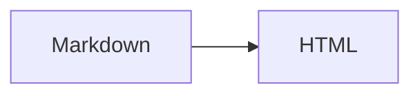

# Renderer capabilities

This internal fixture exercises the authoring features enabled for the design
system. It is deliberately outside the site navigation.

## Annotations

### Annotation proof { #renderer-annotations }

Annotations can be nested inside Markdown-aware blocks. (1)
{ .annotate }

1. The annotation body can contain **formatted text** and a nested marker. (2)
    { .annotate }

    1. This is the nested annotation.

### Formatting proof { #renderer-formatting }

The same specimen exercises **strong text**, nested structure, and inline
`code` without adding a second renderer path.

### List proof { #renderer-lists }

The numbered annotation bodies above exercise the configured list renderer.

## Code actions

### Code-block proof { #renderer-code-blocks }

``` yaml title="renderer.yml" data-download="blob" data-fold="3"
theme:
  name: materialx
  code:
    fold:
      enabled: true # (1)!
```

1. Code annotations can explain a line without cluttering the example.

The canonical include marker is `--8<-- "includes/renderer-snippet.md"`.

--8<-- "includes/renderer-snippet.md:renderer"

### Copy-action proof { #renderer-code-copy }

The rendered code block exposes the configured copy action.

### Selection-action proof { #renderer-code-selection }

The rendered code block exposes the configured selection action.

### Download-action proof { #renderer-code-download }

The `data-download="blob"` attribute exercises the configured download action.

### Folding proof { #renderer-code-fold }

The `data-fold="3"` attribute exercises the configured fold action.

### Code-annotation proof { #renderer-code-annotations }

The numbered marker in the YAML comment exercises code annotations.

### Snippet proof { #renderer-code-snippet }

The tracked include above exercises the configured snippets extension.

### Authored-button proof { #renderer-buttons }

[Renderer action](#renderer-code-blocks){ .md-button }

## Linked tabs

### Content-tabs proof { #renderer-content-tabs }

=== "Source"

    The selected tab is linked across tab groups.

=== "Result"

    The rendered result stays selected.

## Footnotes and glossary tooltips

### Footnote proof { #renderer-footnotes }

The DOM tooltip comes from the tracked glossary.[^renderer]

[^renderer]: Footnote tooltips keep short notes in the reader's context.

## Emoji

### Icon-and-emoji proof { #renderer-icons-emojis }

:material-check: MaterialX emits this icon as inline SVG.

## Diagrams { #renderer-mermaid }

### Diagram proof { #renderer-diagrams }

### Flowchart proof { #renderer-mermaid-flowchart }



## Mathematics { #renderer-mathjax }

### Mathematics proof { #renderer-math }

### Block-math proof { #renderer-mathjax-block }

$$
a^2 + b^2 = c^2
$$

### Inline-math proof { #renderer-mathjax-inline }

The inline expression \(a^2 + b^2 = c^2\) is typeset by MathJax.

## Captions and lightbox

### Image proof { #renderer-images }

[{ loading=lazy }](https://res.cloudinary.com/fontlab/image/upload/f_auto,q_auto/vw/68daa71678eede3413b20f4e_fill-linear.png){ .glightbox }
/// caption
A captioned image opens in the existing GLightbox renderer.
///
